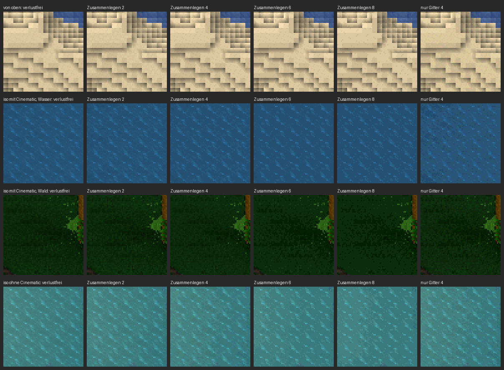

# Farben zusammenlegen vor dem Packen

Legt eine Vorstufe ähnliche Farben einer Kachel zusammen, bevor libwebp sie
kompakt verlustfrei packt, werden die Kacheln bei höchstens 4 Stufen
Abweichung je Kanal 25 bis 30 % kleiner als mit near-lossless 40, an einer
Stichprobe der grossen Welt 35 %. Das Format bleibt das verlustfreie, Alpha
bleibt Bit für Bit, und ein Kanal mit 255 bleibt 255. Ohne den Rückfall
aufs Gitter ist es an der grossen Welt noch 0,7 bis 2,1 % kleiner. Gebaut
ist nichts; welche Stufe gilt, entscheidet der Maintainer.

## Aufbau

- **Frage:** Schlägt eine eigene Vorstufe, zugeschnitten auf die Farben
  unserer Kacheln, near-lossless 40 und verlustbehaftet 95 (#421)?
  Bedingungen: Das Format bleibt VP8L, Alpha bleibt Bit für Bit, und ein
  Kanal mit 255 bleibt 255.
- **Kacheln:** 563 Kacheln der Testwelt in drei Bäumen.
  - Von oben und iso mit Cinematic: die 409 Kacheln aus dem zweiten Lauf
    von
    [Farb-Cache fest statt gesucht](2026-11-13-farbcache-fest-statt-suchen.md),
    182 und 227.
  - Iso ohne Cinematic: die feinsten Stufen derselben vier Ausschnitte mit
    denselben Befehlen ohne `--cinematic`, 154 Kacheln, gerendert mit 0.20.0.
- **Vorstufen:** Sie ändern nur die Farbe sichtbarer Pixel. Danach packt
  libwebp kompakt verlustfrei, wie `kodiere` mit `Packen::Kompakt` in
  [`tiles.rs`](../../renderer/src/render/tiles.rs).
  - **Gitter d:** Jeder Kanal geht auf die Mitte seiner Zelle in einem
    festen Gitter mit Schritt 2 d + 1, höchstens d daneben. 255 bleibt
    255, und kein Wert wird neu 255.
  - **Zusammenlegen d:** Die Farben der Kachel nach Häufigkeit; jede geht
    auf die erste häufigere, die dasselbe Alpha hat, je Kanal höchstens d
    daneben liegt und 255 genau dort hat, wo sie selbst 255 hat. Sonst
    bleibt sie. Bleiben mehr als 256 Farben, bekommt die Kachel
    stattdessen das Gitter d.
  - **Zusammenlegen d ohne Rückfall:** dasselbe Zusammenlegen ohne Grenze
    für die Zahl der Farben und ohne das Gitter. Bleiben mehr als 256
    Farben, packt libwebp die Kachel ohne Palette.
- **Vergleich:**
  - near-lossless 60 und 40 von libwebp, mit festem Alpha, und
    verlustbehaftet 95 und 90, wie in
    [Verlust je Stufe der Pyramide](2026-11-14-verlust-je-stufe-der-pyramide.md),
    „Aufbau“;
  - Prozent der Bytes gegen kompakt verlustfrei.
- **Abweichung:** Farbe an sichtbaren Pixeln, also dort, wo das Original
  Alpha über 0 hat; Alpha an allen Pixeln. Geändert heisst: R, G oder B
  weicht ab. PSNR über R, G und B, nicht mit Alpha gewichtet. Dazu gezählt:
  Kanäle, die 255 waren und es nicht mehr sind.
- **Pyramide:** über den feinsten Stufen der vier Ausschnitte alle Stufen
  bis Stufe 0, Eltern mit `merge` aus
  [`pyramid.rs`](../../renderer/src/render/pyramid.rs) aus den dekodierten
  Kindern, jede Stufe mit derselben Packung, gegen die verlustfreie
  Pyramide. Von oben 114 Kacheln an der Basis, im iso je 154.
- **Grosse Welt:** jede zehnte Kachel des Ausschnitts aus
  [Packungen an einem Ausschnitt der grossen Welt](2026-11-14-packungen-am-ausschnitt-der-grossen-welt.md)
  über alle Stufen, 3 415 im iso mit Cinematic und 2 132 von oben. Gepackt
  lokal mit einem kleinen Programm auf der Kopie von libwebp, mit
  derselben Vorstufe; an den Kacheln der Testwelt gibt es auf das Byte die
  Summen des Tests. Gemessen sind dort nur Bytes und die grösste
  Abweichung, für das Zusammenlegen mit Rückfall dazu die Zahl der
  Rückfälle.
- **Zeit:** Vorstufe und Packen zusammen, ein Thread, je Kachel gestoppt;
  bei near-lossless mit festem Alpha zählt das Packen mit near-lossless.
- **Messcode:** der Tag `versuch/farben-vorstufe`, `cfe87ecf`, Test
  `probe_farben`. Gemessen an Ständen eines Probezweigs mit den Kacheln;
  nicht gemergt. Die Liste der Packungen wechselte je Lauf, der Tag trägt
  die des fünften; die Kopie von libwebp liest dort die Schalter des
  Zuschnitts aus der Umgebung. Der sechste Lauf: der Tag
  `versuch/farben-rein`, `72432d32`; der siebte: der Tag
  `versuch/farben-rein-pyramide`, `79817b39`; der achte: der Tag
  `versuch/farben-rein-schnell`, `9b378406`.
- **Rechner:** die CI, `ubuntu-latest`, Release-Build, ein geteilter
  Rechner.

## Ablauf

Am 15.11.2026, acht Läufe des Workflows an den Ständen `4b669a0e`,
`7e04b9ac`, `b290d5b5`, `b64c2c2e`, `f594858a`, `7c405eae`, `6236d3d9` und
`affd6203`. Die Zahlen sind die Ausgabe des Tests im Log.

- Die Leiter und die Pyramide stammen aus dem vierten Lauf, die
  ausgeschiedenen Vorstufen aus dem zweiten und dritten, der Zuschnitt und
  das Zusammenlegen auf Gitterwerten aus dem fünften, das Zusammenlegen
  ohne Rückfall und die Zahl der Rückfälle aus dem sechsten, seine
  Pyramide und seine Zeit mit dem Zuschnitt aus dem siebten, die
  schnellere Suche aus dem achten.
- Bytes und Abweichungen jeder Packung, die in mehreren Läufen stand, sind
  in allen gleich.
- Der sechste Lauf führt den Test einmal aus; seine Zeiten sind ein
  Anhalt, kein Median.
- Jeder andere Lauf führt den Test dreimal aus. Für die Zeiten der
  Median der drei; gegen kompakt im selben Durchgang liegen die drei
  höchstens 0,9 Prozentpunkte auseinander, im fünften Lauf von oben und
  im iso mit Cinematic höchstens 1,2, im iso ohne Cinematic bis 3,3, im
  achten bis 3,8.
- Die grosse Welt: lokal, vier Threads mit niedrigster Priorität; die
  Zeiten dort zählen nicht.
- Das Aussehen ist keine Messung: Die Ausschnitte unten hat der Researcher
  angesehen.

## Ergebnis

### Farben je Kachel

Verschiedene Farben samt Alpha je Kachel. Eine Kachel mit höchstens 256
Farben packt libwebp mit Palette.

| Kacheln | Zahl | Median je Gruppe | grösste | höchstens 256 Farben |
|---|---|---|---|---|
| Testwelt von oben | 182 | 2 531 bis 3 833 | 20 177 | 3 |
| Testwelt iso mit Cinematic | 227 | 1 495 bis 4 426 | 13 291 | 5 |
| Testwelt iso ohne Cinematic | 154 | 1 414 bis 13 917 | 20 652 | 16, alle am Rand der Welt |
| grosse Welt von oben, feinste Stufe | 794 | 1 453 | 13 359 | 37 % |
| grosse Welt iso mit Cinematic, feinste Stufe | 1 270 | 563 | 17 661 | 44 % |

Die Zeilen der grossen Welt sind jede zwanzigste Kachel der feinsten Stufe
des Ausschnitts, lokal gezählt.

### Leiter von oben

182 Kacheln, 9 058 560 sichtbare Pixel. Kompakt verlustfrei: 8 088 532
Byte, Packen 7,87 ms und Dekodieren 0,65 ms je Kachel.

| Packung | Bytes | grösste Abweichung | geänderte Pixel | PSNR, dB | schlechteste Kachel, dB | mit Palette | Packen | davon Vorstufe, ms | Dekodieren, ms |
|---|---|---|---|---|---|---|---|---|---|
| near-lossless 60 | 66,1 % | 2 | 95,4 % | 46,6 | 46,1 | 10 | +14 % | – | 0,51 |
| near-lossless 40 | 56,4 % | 4 | 96,8 % | 41,4 | 40,1 | 16 | +26 % | – | 0,47 |
| verlustbehaftet 95 | 43,9 % | 123 | 99,0 % | 34,5 | 29,8 | 0 | −20 % | – | 1,27 |
| verlustbehaftet 90 | 31,0 % | 122 | 99,3 % | 33,9 | 29,4 | 0 | −28 % | – | 1,03 |
| Zusammenlegen 1 | 68,4 % | 1 | 91,0 % | 50,1 | 49,2 | 25 | +15 % | 1,15 | 0,52 |
| Zusammenlegen 2 | 57,0 % | 2 | 92,3 % | 45,6 | 44,1 | 53 | +21 % | 1,29 | 0,46 |
| Zusammenlegen 3 | 48,3 % | 3 | 90,8 % | 43,1 | 41,8 | 88 | +25 % | 1,45 | 0,41 |
| Zusammenlegen 4 | 42,4 % | 4 | 88,8 % | 41,7 | 39,6 | 124 | +28 % | 1,63 | 0,38 |
| Zusammenlegen 5 | 37,3 % | 5 | 88,5 % | 40,4 | 37,8 | 153 | +25 % | 1,71 | 0,35 |
| Zusammenlegen 6 | 34,2 % | 6 | 87,8 % | 39,6 | 36,1 | 169 | +26 % | 1,75 | 0,33 |
| Zusammenlegen 8 | 28,8 % | 8 | 89,0 % | 37,5 | 34,7 | 181 | +23 % | 1,75 | 0,29 |
| nur Gitter 2 | 57,4 % | 2 | 99,3 % | 45,0 | 44,1 | 48 | +5 % | 0,06 | 0,46 |
| nur Gitter 4 | 43,7 % | 4 | 99,8 % | 40,2 | 39,5 | 116 | +9 % | 0,06 | 0,39 |
| nur Gitter 8 | 31,2 % | 8 | 100,0 % | 34,8 | 33,6 | 181 | +10 % | 0,06 | 0,31 |

### Leiter im iso mit Cinematic

227 Kacheln, 12 475 196 sichtbare Pixel. Kompakt verlustfrei: 11 293 004
Byte, Packen 8,38 ms und Dekodieren 0,76 ms je Kachel.

| Packung | Bytes | grösste Abweichung | geänderte Pixel | PSNR, dB | schlechteste Kachel, dB | mit Palette | Packen | davon Vorstufe, ms | Dekodieren, ms |
|---|---|---|---|---|---|---|---|---|---|
| near-lossless 60 | 60,0 % | 2 | 95,3 % | 46,7 | 45,9 | 17 | +16 % | – | 0,53 |
| near-lossless 40 | 50,7 % | 4 | 96,8 % | 41,4 | 40,3 | 22 | +25 % | – | 0,48 |
| verlustbehaftet 95 | 51,3 % | 119 | 99,3 % | 35,5 | 30,5 | 0 | −15 % | – | 1,47 |
| verlustbehaftet 90 | 36,2 % | 123 | 99,6 % | 34,7 | 30,2 | 0 | −23 % | – | 1,14 |
| Zusammenlegen 1 | 60,7 % | 1 | 89,0 % | 50,3 | 49,5 | 58 | +14 % | 1,21 | 0,52 |
| Zusammenlegen 2 | 47,4 % | 2 | 90,0 % | 46,2 | 44,7 | 115 | +22 % | 1,39 | 0,44 |
| Zusammenlegen 3 | 40,1 % | 3 | 88,0 % | 44,2 | 41,7 | 159 | +28 % | 1,57 | 0,39 |
| Zusammenlegen 4 | 35,2 % | 4 | 89,3 % | 42,1 | 39,2 | 187 | +31 % | 1,62 | 0,36 |
| Zusammenlegen 5 | 30,8 % | 5 | 90,6 % | 40,7 | 38,1 | 210 | +28 % | 1,66 | 0,32 |
| Zusammenlegen 6 | 27,8 % | 6 | 91,5 % | 39,7 | 36,4 | 223 | +27 % | 1,67 | 0,30 |
| Zusammenlegen 8 | 23,7 % | 8 | 92,7 % | 37,7 | 36,0 | 227 | +24 % | 1,66 | 0,27 |
| nur Gitter 2 | 47,6 % | 2 | 99,1 % | 45,1 | 44,5 | 107 | +5 % | 0,06 | 0,44 |
| nur Gitter 4 | 36,2 % | 4 | 99,9 % | 39,6 | 38,2 | 183 | +10 % | 0,06 | 0,37 |
| nur Gitter 8 | 25,2 % | 8 | 100,0 % | 34,3 | 33,2 | 226 | +13 % | 0,06 | 0,28 |

### Leiter im iso ohne Cinematic

154 Kacheln, 9 502 829 sichtbare Pixel. Kompakt verlustfrei: 9 087 572
Byte, Packen 9,01 ms und Dekodieren 0,83 ms je Kachel.

| Packung | Bytes | grösste Abweichung | geänderte Pixel | PSNR, dB | schlechteste Kachel, dB | mit Palette | Packen | davon Vorstufe, ms | Dekodieren, ms |
|---|---|---|---|---|---|---|---|---|---|
| near-lossless 60 | 64,0 % | 2 | 86,8 % | 46,9 | 46,3 | 19 | +15 % | – | 0,63 |
| near-lossless 40 | 54,3 % | 4 | 88,4 % | 41,8 | 40,4 | 20 | +26 % | – | 0,57 |
| verlustbehaftet 95 | 50,0 % | 118 | 95,5 % | 34,2 | 29,3 | 0 | −16 % | – | 1,58 |
| verlustbehaftet 90 | 36,6 % | 119 | 96,0 % | 33,6 | 29,1 | 0 | −25 % | – | 1,23 |
| Zusammenlegen 1 | 65,8 % | 1 | 90,4 % | 50,1 | 49,8 | 21 | +13 % | 1,24 | 0,64 |
| Zusammenlegen 2 | 51,8 % | 2 | 88,0 % | 46,1 | 43,5 | 64 | +22 % | 1,48 | 0,55 |
| Zusammenlegen 3 | 43,6 % | 3 | 85,2 % | 43,9 | 42,0 | 99 | +30 % | 1,68 | 0,51 |
| Zusammenlegen 4 | 38,2 % | 4 | 86,1 % | 42,0 | 39,8 | 124 | +33 % | 1,80 | 0,46 |
| Zusammenlegen 5 | 34,1 % | 5 | 87,0 % | 40,5 | 38,1 | 148 | +36 % | 1,89 | 0,42 |
| Zusammenlegen 6 | 31,2 % | 6 | 88,0 % | 39,4 | 36,5 | 153 | +35 % | 1,97 | 0,38 |
| Zusammenlegen 8 | 26,8 % | 8 | 89,8 % | 37,4 | 35,6 | 154 | +32 % | 1,89 | 0,34 |
| nur Gitter 2 | 52,4 % | 2 | 97,1 % | 45,2 | 43,0 | 53 | +5 % | 0,06 | 0,55 |
| nur Gitter 4 | 39,1 % | 4 | 99,7 % | 40,0 | 37,9 | 123 | +14 % | 0,06 | 0,47 |
| nur Gitter 8 | 28,8 % | 8 | 99,2 % | 34,7 | 33,5 | 154 | +19 % | 0,06 | 0,35 |

### Alpha und 255

- Jede Vorstufe lässt Alpha an jedem Pixel und jeden Kanal mit 255 stehen
  und macht keinen neu zu 255, auch über die Pyramide.
- near-lossless von libwebp lässt 255 stehen, macht aber von oben 873
  Kanäle (60) und 1 323 (40) neu zu 255, ohne Cinematic 201 und 353.
- Verlustbehaftet verliert von oben 3 430 Kanäle mit 255 (95) und 3 697
  (90), ohne Cinematic je 432, mit Cinematic keinen.

### Grosse Welt

Bytes in Prozent von kompakt verlustfrei, über alle Stufen der Stichprobe.

| Packung | iso mit Cinematic | von oben | grösste Abweichung |
|---|---|---|---|
| near-lossless 60 | 72,2 % | 77,4 % | 2 |
| near-lossless 40 | 65,2 % | 70,8 % | 4 |
| verlustbehaftet 95 | 64,7 % | 54,8 % | – |
| verlustbehaftet 90 | 42,5 % | 34,6 % | – |
| Zusammenlegen 2 | 54,0 % | 62,2 % | 2 |
| Zusammenlegen 3 | 46,1 % | 53,7 % | 3 |
| Zusammenlegen 4 | 41,6 % | 45,7 % | 4 |
| Zusammenlegen 6 | 32,2 % | 36,3 % | 6 |
| Zusammenlegen 8 | 26,9 % | 29,9 % | 8 |
| nur Gitter 2 | 54,5 % | 63,2 % | 2 |
| nur Gitter 4 | 43,3 % | 50,6 % | 4 |
| nur Gitter 8 | 29,9 % | 40,6 % | 8 |

- Kompakt verlustfrei hat die Stichprobe 109 998 750 Byte im iso und
  65 290 434 von oben.
- Die Bytes für verlustbehaftet stammen aus den Bytes je Kachel der
  Messung am Ausschnitt; ihre Abweichung steht dort.
- near-lossless ist hier das von libwebp ohne festes Alpha.

### Pyramide von oben

PSNR in dB und grösste Abweichung der Farbe, als „PSNR / grösste“. Von
oben bleibt je 2 × 2 ein Pixel.

| Stufe | sichtbare Pixel | near-lossless 40 | verlustbehaftet 90 | Zusammenlegen 2 | Zusammenlegen 4 | Zusammenlegen 8 | nur Gitter 4 |
|---|---|---|---|---|---|---|---|
| 0 | 6 901 760 | 41,4 / 4 | 34,1 / 122 | 45,6 / 2 | 41,7 / 4 | 37,5 / 8 | 40,2 / 4 |
| 1 | 1 725 440 | 40,8 / 5 | 32,1 / 114 | 45,1 / 4 | 40,6 / 8 | 36,6 / 16 | 40,3 / 4 |
| 2 | 431 360 | 40,3 / 5 | 30,6 / 114 | 44,8 / 5 | 39,9 / 12 | 37,1 / 23 | 40,0 / 4 |
| 3 | 107 840 | 40,2 / 5 | 29,2 / 113 | 44,4 / 5 | 39,7 / 12 | 36,7 / 24 | 40,0 / 4 |
| 4 | 26 960 | 40,2 / 5 | 27,8 / 117 | 44,4 / 5 | 39,6 / 12 | 36,7 / 23 | 40,0 / 4 |
| 5 | 6 740 | 40,3 / 5 | 26,3 / 121 | 44,4 / 5 | 39,6 / 12 | 36,5 / 23 | 40,0 / 4 |
| 6 | 1 685 | 40,2 / 5 | 24,5 / 102 | 44,4 / 5 | 39,7 / 11 | 36,6 / 18 | 40,1 / 4 |
| Bytes aller Stufen | 8 275 978 Byte | 55,2 % | 30,7 % | 57,2 % | 42,4 % | 29,0 % | 43,9 % |

### Pyramide im iso mit Cinematic

Im iso mittelt das Verkleinern.

| Stufe | sichtbare Pixel | near-lossless 40 | verlustbehaftet 90 | Zusammenlegen 2 | Zusammenlegen 4 | Zusammenlegen 8 | nur Gitter 4 |
|---|---|---|---|---|---|---|---|
| 0 | 9 502 829 | 41,4 / 4 | 34,4 / 123 | 46,3 / 2 | 42,5 / 4 | 37,7 / 8 | 39,6 / 4 |
| 1 | 2 377 601 | 39,9 / 9 | 34,4 / 101 | 44,6 / 5 | 40,1 / 8 | 36,1 / 16 | 38,8 / 8 |
| 2 | 594 766 | 39,3 / 11 | 34,6 / 77 | 44,0 / 6 | 39,4 / 10 | 35,5 / 21 | 38,2 / 10 |
| 3 | 148 847 | 39,2 / 10 | 34,4 / 70 | 43,7 / 6 | 39,0 / 11 | 35,1 / 23 | 37,5 / 11 |
| 4 | 37 300 | 38,9 / 11 | 33,8 / 83 | 43,0 / 6 | 38,8 / 12 | 34,7 / 21 | 36,9 / 11 |
| 5 | 9 368 | 38,6 / 10 | 32,7 / 46 | 43,2 / 6 | 38,8 / 12 | 34,4 / 20 | 36,2 / 12 |
| 6 | 2 361 | 38,1 / 10 | 31,1 / 56 | 44,0 / 6 | 39,2 / 10 | 34,0 / 20 | 35,5 / 12 |
| Bytes aller Stufen | 11 593 710 Byte | 51,2 % | 35,5 % | 47,7 % | 35,0 % | 23,2 % | 36,6 % |

### Pyramide im iso ohne Cinematic

| Stufe | sichtbare Pixel | near-lossless 40 | verlustbehaftet 90 | Zusammenlegen 2 | Zusammenlegen 4 | Zusammenlegen 8 | nur Gitter 4 |
|---|---|---|---|---|---|---|---|
| 0 | 9 502 829 | 41,8 / 4 | 33,6 / 119 | 46,1 / 2 | 42,0 / 4 | 37,4 / 8 | 40,0 / 4 |
| 1 | 2 377 601 | 40,2 / 9 | 33,8 / 121 | 44,2 / 5 | 39,8 / 8 | 35,7 / 16 | 39,1 / 8 |
| 2 | 594 766 | 39,6 / 11 | 34,1 / 107 | 43,4 / 6 | 39,3 / 11 | 34,7 / 21 | 38,5 / 11 |
| 3 | 148 847 | 39,6 / 11 | 34,0 / 91 | 42,6 / 6 | 39,1 / 11 | 34,3 / 22 | 37,8 / 11 |
| 4 | 37 300 | 39,4 / 12 | 33,5 / 92 | 41,8 / 6 | 38,8 / 11 | 33,9 / 24 | 36,9 / 13 |
| 5 | 9 368 | 39,0 / 12 | 32,5 / 59 | 41,6 / 7 | 39,3 / 11 | 33,8 / 24 | 36,0 / 12 |
| 6 | 2 361 | 38,7 / 11 | 30,8 / 67 | 42,8 / 6 | 39,4 / 10 | 34,2 / 19 | 35,0 / 12 |
| Bytes aller Stufen | 13 151 622 Byte | 53,0 % | 32,4 % | 52,0 % | 37,8 % | 25,4 % | 38,7 % |

### Mit dem Zuschnitt von libwebp

Über alle Stufen der Pyramide, Eltern aus den dekodierten Kindern, 214
Kacheln von oben und 276 im iso mit Cinematic; Packen samt Vorstufe in ms
je Kachel. „Gegen heute“ ist gegen das kompakte Packen von heute ohne
Dekodieren, „mit Dekodieren“ ist Packen plus Dekodieren dagegen. Der
Zuschnitt ist Stufe 4 aus
[libwebp für Kacheln zuschneiden](2026-11-14-libwebp-zuschneiden.md):
Farb-Cache fest, ohne RLE, ohne Analyse der Entropie.

| Packung | von oben: Packen, ms | gegen heute | mit Dekodieren | Bytes | iso: Packen, ms | gegen heute | mit Dekodieren | Bytes |
|---|---|---|---|---|---|---|---|---|
| kompakt heute | 6,86 | – | +8,2 % | 100,0 % | 6,93 | – | +9,0 % | 100,0 % |
| kompakt mit Zuschnitt | 4,80 | −29,9 % | −21,7 % | 100,0 % | 4,58 | −34,0 % | −25,0 % | 100,0 % |
| near-lossless 40 | 8,55 | +24,9 % | +30,7 % | 55,2 % | 8,89 | +28,5 % | +34,6 % | 51,2 % |
| near-lossless 40 mit Zuschnitt | 6,82 | −0,5 % | +5,4 % | 55,4 % | 6,93 | −0,1 % | +5,8 % | 51,2 % |
| Zusammenlegen 2 | 8,40 | +22,6 % | +28,5 % | 57,2 % | 8,76 | +26,4 % | +31,9 % | 47,7 % |
| Zusammenlegen 2 mit Zuschnitt | 6,63 | −3,2 % | +2,8 % | 57,5 % | 6,87 | −0,8 % | +4,6 % | 48,0 % |
| Zusammenlegen 4 | 8,82 | +28,7 % | +33,7 % | 42,4 % | 9,38 | +35,4 % | +39,7 % | 35,0 % |
| Zusammenlegen 4 mit Zuschnitt | 7,30 | +6,5 % | +11,4 % | 43,1 % | 7,80 | +12,4 % | +16,7 % | 35,5 % |
| Zusammenlegen 8 | 8,57 | +25,0 % | +28,9 % | 29,0 % | 8,84 | +27,5 % | +30,8 % | 23,2 % |
| Zusammenlegen 8 mit Zuschnitt | 7,55 | +10,1 % | +14,0 % | 29,4 % | 7,84 | +13,2 % | +16,7 % | 23,3 % |
| nur Gitter 4 | 7,55 | +10,2 % | +15,3 % | 43,9 % | 7,78 | +12,2 % | +16,7 % | 36,6 % |
| nur Gitter 4 mit Zuschnitt | 5,97 | −12,8 % | −7,8 % | 44,7 % | 6,09 | −12,1 % | −7,7 % | 37,0 % |
| verlustbehaftet 90 | 5,36 | −21,8 % | −7,9 % | 30,7 % | 5,91 | −14,8 % | +0,5 % | 35,5 % |

- Im iso ohne Cinematic packt Zusammenlegen 2, 4 und 8 mit Zuschnitt um
  −2,9, +12,2 und +19,1 % gegen heute, mit Dekodieren um +3,4, +17,1 und
  +23,1 %.
- Die Pixel sind mit und ohne Zuschnitt auf jeder Stufe gleich.
- Mit Zuschnitt wachsen die Bytes von Zusammenlegen 4 um 1,3 bis 1,7 %, von
  Zusammenlegen 2 um 0,4 bis 0,7 %, von Zusammenlegen 8 um 0,4 bis 1,2 %
  und von nur Gitter 4 um 1,3 bis 1,6 %; kompakt um 0,04 %, near-lossless
  40 um 0,1 bis 0,2 %.

### Von oben: die Grenze über die Pyramide

Welche Packung von oben die grösste Abweichung über die Stufen hält; PSNR
in dB und grösste Abweichung als „PSNR / grösste“.

| Lauf | Stufe 0 | 1 | 2 | 3 | 4 | 5 | 6 | Bytes aller Stufen |
|---|---|---|---|---|---|---|---|---|
| nur Gitter 4 | 40,2 / 4 | 40,3 / 4 | 40,0 / 4 | 40,0 / 4 | 40,0 / 4 | 40,0 / 4 | 40,1 / 4 | 43,9 % |
| Zusammenlegen 4 | 41,7 / 4 | 40,6 / 8 | 39,9 / 12 | 39,7 / 12 | 39,6 / 12 | 39,6 / 12 | 39,7 / 11 | 42,4 % |
| Gitter 1, darauf Zusammenlegen 3 | 41,6 / 4 | 40,7 / 7 | 40,0 / 10 | 39,9 / 10 | 39,8 / 10 | 39,8 / 10 | 39,9 / 9 | 42,1 % |
| Basis Zusammenlegen 4, Eltern Gitter 4 | 41,7 / 4 | 39,0 / 8 | 38,8 / 8 | 38,8 / 8 | 38,8 / 8 | 38,8 / 8 | 38,9 / 8 | 42,0 % |
| Zusammenlegen 2 | 45,6 / 2 | 45,1 / 4 | 44,8 / 5 | 44,4 / 5 | 44,4 / 5 | 44,4 / 5 | 44,4 / 5 | 57,2 % |
| Basis Zusammenlegen 2, Eltern Gitter 2 | 45,6 / 2 | 44,5 / 4 | 44,4 / 4 | 44,4 / 4 | 44,4 / 4 | 44,4 / 4 | 44,4 / 4 | 57,1 % |

- **Erst das Gitter, dann darauf zusammenlegen** ist mit derselben Grenze
  das Gitter selbst: Zwei verschiedene Gitterwerte liegen 2 d + 1
  auseinander, nie höchstens d. Mit feinerem Gitter, hier Gitter 1 und
  darauf Zusammenlegen 3, zusammen höchstens 4, wächst die grösste
  Abweichung über die Stufen wie beim Zusammenlegen allein: Wohin eine
  Farbe geht, hängt an der Kachel, und die Eltern mischen vier Kacheln.
- **Zusammenlegen an der Basis und das Gitter für die Eltern** hält von
  oben eine feste Grenze: d an der Basis, genau 2 d auf jeder Stufe
  darüber.
- **Im iso** taugt das Gitter für die Eltern nicht: Basis Zusammenlegen 4
  und Eltern Gitter 4 fallen dort von 42,5 dB auf 38,6, 38,3, 37,8 und
  37,3 dB in Stufe 4; mit Zusammenlegen auf allen Stufen sind es dort
  38,8 dB.

### Zusammenlegen ohne Rückfall

Aus dem sechsten Lauf, beide Zeilen je Grenze aus demselben Durchgang.
„Aufs Gitter gefallen“ zählt die Kacheln, die mehr als 256 Farben
behalten und darum das Gitter bekommen. „Packen“ ist ein Durchgang gegen
kompakt verlustfrei, nur als Anhalt.

Von oben, 182 Kacheln:

| Packung | Bytes | grösste Abweichung | geänderte Pixel | PSNR, dB | schlechteste Kachel, dB | mit Palette | aufs Gitter gefallen | Packen | davon Vorstufe, ms |
|---|---|---|---|---|---|---|---|---|---|
| Zusammenlegen 2 | 57,0 % | 2 | 92,3 % | 45,6 | 44,1 | 53 | 132 | +20 % | 1,26 |
| Zusammenlegen 2 ohne Rückfall | 56,1 % | 2 | 72,5 % | 48,0 | 46,5 | 50 | – | +39 % | 2,48 |
| Zusammenlegen 3 | 48,3 % | 3 | 90,8 % | 43,1 | 41,8 | 88 | 105 | +24 % | 1,42 |
| Zusammenlegen 3 ohne Rückfall | 47,9 % | 3 | 78,7 % | 44,9 | 43,5 | 77 | – | +34 % | 2,11 |
| Zusammenlegen 4 | 42,4 % | 4 | 88,8 % | 41,7 | 39,6 | 124 | 61 | +27 % | 1,59 |
| Zusammenlegen 4 ohne Rückfall | 41,8 % | 4 | 82,4 % | 42,9 | 41,2 | 121 | – | +31 % | 1,94 |

Iso mit Cinematic, 227 Kacheln:

| Packung | Bytes | grösste Abweichung | geänderte Pixel | PSNR, dB | schlechteste Kachel, dB | mit Palette | aufs Gitter gefallen | Packen | davon Vorstufe, ms |
|---|---|---|---|---|---|---|---|---|---|
| Zusammenlegen 2 | 47,4 % | 2 | 90,0 % | 46,2 | 44,7 | 115 | 127 | +21 % | 1,37 |
| Zusammenlegen 2 ohne Rückfall | 47,2 % | 2 | 79,3 % | 47,8 | 46,7 | 100 | – | +33 % | 2,15 |
| Zusammenlegen 3 | 40,1 % | 3 | 88,0 % | 44,2 | 41,7 | 159 | 68 | +27 % | 1,53 |
| Zusammenlegen 3 ohne Rückfall | 40,2 % | 3 | 84,4 % | 45,0 | 43,8 | 159 | – | +33 % | 1,89 |
| Zusammenlegen 4 | 35,2 % | 4 | 89,3 % | 42,1 | 39,2 | 187 | 49 | +30 % | 1,58 |
| Zusammenlegen 4 ohne Rückfall | 35,4 % | 4 | 87,5 % | 42,8 | 41,4 | 178 | – | +33 % | 1,78 |

Iso ohne Cinematic, 154 Kacheln:

| Packung | Bytes | grösste Abweichung | geänderte Pixel | PSNR, dB | schlechteste Kachel, dB | mit Palette | aufs Gitter gefallen | Packen | davon Vorstufe, ms |
|---|---|---|---|---|---|---|---|---|---|
| Zusammenlegen 2 | 51,8 % | 2 | 88,0 % | 46,1 | 43,5 | 64 | 93 | +22 % | 1,47 |
| Zusammenlegen 2 ohne Rückfall | 52,0 % | 2 | 74,8 % | 47,9 | 46,3 | 61 | – | +45 % | 3,32 |
| Zusammenlegen 3 | 43,6 % | 3 | 85,2 % | 43,9 | 42,0 | 99 | 58 | +29 % | 1,67 |
| Zusammenlegen 3 ohne Rückfall | 44,3 % | 3 | 80,5 % | 44,9 | 43,5 | 96 | – | +40 % | 2,57 |
| Zusammenlegen 4 | 38,2 % | 4 | 86,1 % | 42,0 | 39,8 | 124 | 39 | +33 % | 1,79 |
| Zusammenlegen 4 ohne Rückfall | 38,9 % | 4 | 84,2 % | 42,7 | 41,1 | 115 | – | +39 % | 2,26 |

Grosse Welt, dieselbe Stichprobe wie in „Grosse Welt“, Bytes in Prozent
von kompakt verlustfrei; die grösste Abweichung ist in jeder Zeile d.
Gemessen sind dort auch ohne Rückfall nur Bytes und die grösste
Abweichung, die PSNR nur an der Testwelt:

| Packung | iso mit Cinematic | aufs Gitter gefallen | von oben | aufs Gitter gefallen |
|---|---|---|---|---|
| Zusammenlegen 2 | 54,0 % | 1 443 von 3 415 | 62,2 % | 925 von 2 132 |
| Zusammenlegen 2 ohne Rückfall | 53,6 % | – | 61,0 % | – |
| Zusammenlegen 3 | 46,1 % | 1 211 | 53,7 % | 690 |
| Zusammenlegen 3 ohne Rückfall | 45,5 % | – | 52,5 % | – |
| Zusammenlegen 4 | 41,6 % | 906 | 45,7 % | 448 |
| Zusammenlegen 4 ohne Rückfall | 41,0 % | – | 44,9 % | – |

- **Bytes:** Ohne Rückfall liegt die Testwelt zwischen 1,5 % kleiner und
  1,9 % grösser als mit Rückfall: von oben 0,7 bis 1,5 % kleiner, im iso
  mit Cinematic −0,3 bis +0,3 %, im iso ohne 0,5 bis 1,9 % grösser. An der
  grossen Welt ist es überall kleiner, im iso um 0,7 bis 1,4 %, von oben
  um 1,8 bis 2,1 %.
- **Abweichung:** Ohne Rückfall sind es an der Testwelt 0,7 bis 2,4 dB
  mehr PSNR, die schlechteste Kachel ist 1,3 bis 2,8 dB besser, und es
  ändern sich weniger Pixel, bei 2 sind es 72 bis 79 % statt 88 bis 92 %.
  Die grösste Abweichung bleibt d, Alpha und 255 bleiben stehen. An der
  grossen Welt ist die PSNR nicht gemessen.
- **Rückfälle:** An der Testwelt fallen bei 2 je Baum 56 bis 73 % der
  Kacheln aufs Gitter, bei 4 noch 22 bis 34 %; an der grossen Welt 42 und
  43 % bei 2, 27 und 21 % bei 4.
- **Palette:** Ohne Rückfall packen gleich viele oder bis zu 15 Kacheln
  weniger mit Palette: Ein Teil der Kacheln, die aufs Gitter fallen, kommt
  dort auf höchstens 256 Farben.
- **Zeit:** In dem einen Durchgang packt es ohne Rückfall 31 bis 45 %
  langsamer als kompakt verlustfrei, mit Rückfall 20 bis 33 %; die Vorstufe
  braucht 1,8 bis 3,3 ms statt 1,3 bis 1,8 ms je Kachel.
- **Pyramide und Zeit mit dem Zuschnitt:** in den beiden Abschnitten
  darunter.

### Pyramide ohne Rückfall

Aus dem siebten Lauf, gebaut wie die Pyramiden oben: jede Stufe mit
derselben Packung, Eltern aus den dekodierten Kindern. PSNR in dB und
grösste Abweichung der Farbe als „PSNR / grösste“.

Von oben, 214 Kacheln; in den letzten drei Spalten packt die Basis ohne
Rückfall und jede Stufe darüber mit dem Gitter:

| Stufe | sichtbare Pixel | Zusammenlegen 2 | 2 ohne Rückfall | Zusammenlegen 3 | 3 ohne Rückfall | Zusammenlegen 4 | 4 ohne Rückfall | 2 ohne Rückfall, Eltern Gitter 2 | 3 ohne Rückfall, Eltern Gitter 3 | 4 ohne Rückfall, Eltern Gitter 4 |
|---|---|---|---|---|---|---|---|---|---|---|
| 0 | 6 901 760 | 45,6 / 2 | 47,9 / 2 | 43,1 / 3 | 44,8 / 3 | 41,7 / 4 | 42,7 / 4 | 47,9 / 2 | 44,8 / 3 | 42,7 / 4 |
| 1 | 1 725 440 | 45,1 / 4 | 47,6 / 4 | 42,2 / 6 | 44,3 / 6 | 40,6 / 8 | 42,2 / 8 | 43,2 / 4 | 40,3 / 6 | 38,6 / 8 |
| 2 | 431 360 | 44,8 / 5 | 47,4 / 6 | 41,7 / 9 | 44,5 / 9 | 39,9 / 12 | 42,2 / 12 | 43,1 / 4 | 40,4 / 6 | 38,4 / 8 |
| 3 | 107 840 | 44,4 / 5 | 47,2 / 7 | 41,4 / 11 | 44,2 / 9 | 39,7 / 12 | 41,9 / 12 | 43,1 / 4 | 40,4 / 6 | 38,4 / 8 |
| 4 | 26 960 | 44,4 / 5 | 47,2 / 6 | 41,4 / 9 | 44,2 / 8 | 39,6 / 12 | 41,9 / 11 | 43,1 / 4 | 40,3 / 6 | 38,4 / 8 |
| 5 | 6 740 | 44,4 / 5 | 47,3 / 6 | 41,3 / 9 | 44,3 / 8 | 39,6 / 12 | 41,9 / 11 | 43,1 / 4 | 40,3 / 6 | 38,4 / 8 |
| 6 | 1 685 | 44,4 / 5 | 47,3 / 6 | 41,3 / 7 | 44,3 / 7 | 39,7 / 11 | 42,0 / 11 | 43,1 / 4 | 40,3 / 6 | 38,5 / 8 |
| Bytes aller Stufen | 8 275 978 Byte | 57,2 % | 56,7 % | 48,5 % | 48,4 % | 42,4 % | 42,0 % | 55,5 % | 47,4 % | 41,1 % |

Iso mit Cinematic, 276 Kacheln:

| Stufe | sichtbare Pixel | Zusammenlegen 2 | 2 ohne Rückfall | Zusammenlegen 3 | 3 ohne Rückfall | Zusammenlegen 4 | 4 ohne Rückfall |
|---|---|---|---|---|---|---|---|
| 0 | 9 502 829 | 46,3 / 2 | 47,9 / 2 | 44,5 / 3 | 45,2 / 3 | 42,5 / 4 | 42,8 / 4 |
| 1 | 2 377 601 | 44,6 / 5 | 46,0 / 5 | 42,1 / 7 | 43,2 / 6 | 40,1 / 8 | 41,0 / 8 |
| 2 | 594 766 | 44,0 / 6 | 45,3 / 6 | 41,5 / 8 | 42,4 / 8 | 39,4 / 10 | 40,5 / 10 |
| 3 | 148 847 | 43,7 / 6 | 45,1 / 6 | 41,1 / 9 | 42,1 / 8 | 39,0 / 11 | 40,2 / 11 |
| 4 | 37 300 | 43,0 / 6 | 44,9 / 7 | 40,3 / 9 | 42,0 / 9 | 38,8 / 12 | 39,8 / 12 |
| 5 | 9 368 | 43,2 / 6 | 44,8 / 6 | 40,6 / 9 | 41,8 / 9 | 38,8 / 12 | 39,6 / 12 |
| 6 | 2 361 | 44,0 / 6 | 44,6 / 6 | 41,0 / 9 | 41,7 / 9 | 39,2 / 10 | 39,6 / 10 |
| Bytes aller Stufen | 11 593 710 Byte | 47,7 % | 46,8 % | 40,1 % | 39,8 % | 35,0 % | 34,7 % |

Iso ohne Cinematic, 276 Kacheln:

| Stufe | sichtbare Pixel | Zusammenlegen 2 | 2 ohne Rückfall | Zusammenlegen 3 | 3 ohne Rückfall | Zusammenlegen 4 | 4 ohne Rückfall |
|---|---|---|---|---|---|---|---|
| 0 | 9 502 829 | 46,1 / 2 | 47,9 / 2 | 43,9 / 3 | 44,9 / 3 | 42,0 / 4 | 42,7 / 4 |
| 1 | 2 377 601 | 44,2 / 5 | 46,1 / 4 | 41,6 / 6 | 43,0 / 6 | 39,8 / 8 | 40,9 / 8 |
| 2 | 594 766 | 43,4 / 6 | 45,2 / 6 | 40,4 / 8 | 42,2 / 8 | 39,3 / 11 | 40,0 / 11 |
| 3 | 148 847 | 42,6 / 6 | 44,8 / 6 | 40,0 / 9 | 41,8 / 9 | 39,1 / 11 | 39,7 / 11 |
| 4 | 37 300 | 41,8 / 6 | 44,6 / 6 | 39,7 / 9 | 41,4 / 9 | 38,8 / 11 | 39,3 / 11 |
| 5 | 9 368 | 41,6 / 7 | 44,3 / 6 | 40,3 / 9 | 41,2 / 8 | 39,3 / 11 | 39,0 / 13 |
| 6 | 2 361 | 42,8 / 6 | 44,0 / 6 | 40,7 / 8 | 40,8 / 9 | 39,4 / 10 | 38,7 / 11 |
| Bytes aller Stufen | 13 151 622 Byte | 52,0 % | 52,1 % | 43,5 % | 43,8 % | 37,8 % | 37,9 % |

- **PSNR:** Bis Stufe 4 liegt es ohne Rückfall auf jeder Stufe höher: von
  oben um 2,2 bis 2,8 dB bei 2, um 1,7 bis 2,9 dB bei 3 und um 1,0 bis
  2,3 dB bei 4; im iso mit Cinematic um 1,3 bis 2,0, 0,7 bis 1,7 und 0,3
  bis 1,1 dB; im iso ohne um 1,8 bis 2,8, 1,0 bis 1,8 und 0,5 bis 1,1 dB.
  In Stufe 5 und 6 des iso ohne Cinematic, mit unter 10 000 sichtbaren
  Pixeln, liegt 4 ohne Rückfall 0,3 und 0,7 dB darunter.
- **Grösste Abweichung:** Sie wächst über die Stufen wie mit Rückfall:
  bei 2, 3 und 4 bis 7, 9 und 12 von oben und im iso mit Cinematic, bis
  6, 9 und 13 im iso ohne. Mit Rückfall sind es 5, 11 und 12 von oben, 6,
  9 und 12 im iso mit und 7, 9 und 11 im iso ohne.
- **Bytes aller Stufen:** gegen mit Rückfall von oben 0,1 bis 0,9 %
  kleiner, im iso mit Cinematic 0,8 bis 1,8 % kleiner, im iso ohne 0,2
  bis 0,6 % grösser.
- **Von oben mit dem Gitter für die Eltern:** Die grösste Abweichung ist
  auf jeder Stufe über der Basis genau 2 d, und es ist mit 55,5, 47,4 und
  41,1 % am kleinsten. Über der Basis sind es dann 43,1 bis 43,2, 40,3
  bis 40,4 und 38,4 bis 38,6 dB statt 47,2 bis 47,6, 44,2 bis 44,5 und
  41,9 bis 42,2 dB.
- **Im iso** fällt das Gitter für die Eltern von Stufe zu Stufe: mit
  Cinematic bei 4 von 42,8 dB auf 38,6, 38,3, 37,9 und 37,4 dB in Stufe
  4, ohne Rückfall auf allen Stufen sind es dort 39,8 dB.
- Alpha und jeder Kanal mit 255 bleiben auf jeder Stufe stehen.

### Ohne Rückfall mit dem Zuschnitt von libwebp

Aus dem siebten Lauf, über alle Stufen der Pyramide wie in „Mit dem
Zuschnitt von libwebp“, 214 Kacheln von oben und je 276 im iso; Packen
samt Vorstufe in ms je Kachel. Die Zeiten sind der Median aus drei
Durchgängen auf der CI, einem geteilten Rechner; gegen kompakt im selben
Durchgang liegen die drei höchstens 0,9 Prozentpunkte auseinander.

| Packung | von oben: Packen, ms | gegen heute | mit Dekodieren | iso mit Cinematic: Packen, ms | gegen heute | mit Dekodieren | iso ohne Cinematic: Packen, ms | gegen heute | mit Dekodieren |
|---|---|---|---|---|---|---|---|---|---|
| kompakt heute | 6,87 | – | +8,2 % | 6,90 | – | +9,0 % | 6,88 | – | +9,6 % |
| kompakt mit Zuschnitt | 4,80 | −30,1 % | −21,9 % | 4,57 | −33,8 % | −24,7 % | 4,60 | −33,1 % | −23,6 % |
| Zusammenlegen 2 | 8,45 | +23,0 % | +29,1 % | 8,72 | +26,3 % | +31,9 % | 8,65 | +25,7 % | +32,4 % |
| Zusammenlegen 2 mit Zuschnitt | 6,65 | −3,1 % | +2,9 % | 6,85 | −0,6 % | +4,7 % | 6,71 | −2,6 % | +3,9 % |
| 2 ohne Rückfall | 9,66 | +40,8 % | +46,8 % | 9,53 | +38,0 % | +43,6 % | 10,51 | +52,6 % | +59,1 % |
| 2 ohne Rückfall mit Zuschnitt | 7,87 | +14,7 % | +20,6 % | 7,69 | +11,4 % | +16,7 % | 8,60 | +24,9 % | +31,3 % |
| Zusammenlegen 3 | 8,64 | +26,0 % | +31,5 % | 9,14 | +32,3 % | +37,2 % | 9,16 | +33,1 % | +39,1 % |
| Zusammenlegen 3 mit Zuschnitt | 6,97 | +1,5 % | +6,9 % | 7,42 | +7,6 % | +12,3 % | 7,25 | +5,4 % | +11,0 % |
| 3 ohne Rückfall | 9,31 | +35,6 % | +41,0 % | 9,58 | +38,7 % | +43,6 % | 10,10 | +46,9 % | +52,7 % |
| 3 ohne Rückfall mit Zuschnitt | 7,67 | +11,7 % | +17,0 % | 7,86 | +13,9 % | +18,6 % | 8,26 | +20,0 % | +25,6 % |
| Zusammenlegen 4 | 8,79 | +28,1 % | +33,1 % | 9,32 | +35,0 % | +39,4 % | 9,42 | +36,8 % | +42,0 % |
| Zusammenlegen 4 mit Zuschnitt | 7,29 | +6,1 % | +11,0 % | 7,76 | +12,4 % | +16,7 % | 7,70 | +11,9 % | +16,8 % |
| 4 ohne Rückfall | 9,13 | +33,1 % | +38,0 % | 9,51 | +37,7 % | +42,1 % | 9,92 | +44,1 % | +49,3 % |
| 4 ohne Rückfall mit Zuschnitt | 7,61 | +11,1 % | +15,9 % | 7,95 | +15,2 % | +19,5 % | 8,22 | +19,5 % | +24,5 % |

- **Mit Zuschnitt** packt es ohne Rückfall 11 bis 25 % langsamer als
  kompakt heute, mit Rückfall zwischen 3 % schneller und 12 % langsamer;
  samt dem Dekodieren der Kinder 16 bis 31 % gegen 3 bis 17 %.
- **Ohne Zuschnitt** sind es 33 bis 53 % gegen 23 bis 37 %.
- **Der Unterschied ist die Vorstufe:** 1,7 bis 3,0 ms je Kachel ohne
  Rückfall gegen 1,2 bis 1,6 ms. Jede Farbe sucht ihren Vertreter der
  Reihe nach unter allen bisherigen; mit Rückfall bricht die Suche beim
  257. Vertreter ab. Bei 2 bleiben die meisten Farben, dort ist der
  Abstand am grössten, 12 bis 28 Prozentpunkte mit Zuschnitt; bei 4 sind
  es 3 bis 8. Die Vorstufe im Test ist nicht optimiert.
- **Bytes:** Der Zuschnitt kostet ohne Rückfall 0,3 bis 1,6 %, mit
  Rückfall 0,4 bis 1,7 %.
- Die Pixel sind mit und ohne Zuschnitt auf jeder Stufe gleich.

### Ohne Rückfall mit schnellerer Suche

Aus dem achten Lauf. Die Vorstufe legt genau so zusammen wie bisher,
sucht aber schneller:

- Sie zählt und ersetzt die Farben über eine Tabelle mit einem Hash aus
  einer Multiplikation, wie ihn `Streuer` in
  [`metatile.rs`](../../renderer/src/render/metatile.rs) hat.
- Sie überspringt Läufe gleicher Pixel.
- Die Vertreter stehen je Rotwert in einer Liste. Gesucht wird nur in den
  Listen, deren Rot höchstens d daneben liegt; der früheste Treffer
  gewinnt wie bisher.

Der Test vergleicht auf jeder Kachel jeder Stufe bei 1, 2, 3, 4 und 8 das
Ergebnis mit dem der einfachen Suche: Es ist Pixel für Pixel gleich. Bytes
und Abweichungen jeder Zeile sind die des siebten Laufs.

Zeit über alle Stufen wie im Abschnitt davor, Median aus drei Durchgängen
auf der CI. Dieser Lauf streut mehr: Gegen kompakt im selben Durchgang
liegen die drei bis 2,8 Prozentpunkte auseinander, die Zeilen mit der
einfachen Suche ohne Rückfall bis 3,8. Verglichen wird nur innerhalb des
Laufs.

| Packung | von oben: Packen, ms | gegen heute | mit Dekodieren | iso mit Cinematic: Packen, ms | gegen heute | mit Dekodieren | iso ohne Cinematic: Packen, ms | gegen heute | mit Dekodieren |
|---|---|---|---|---|---|---|---|---|---|
| kompakt heute | 6,85 | – | +7,7 % | 7,03 | – | +8,5 % | 6,98 | – | +8,7 % |
| kompakt mit Zuschnitt | 4,75 | −30,6 % | −22,9 % | 4,56 | −35,2 % | −26,9 % | 4,66 | −33,3 % | −24,6 % |
| Zusammenlegen 2 mit Zuschnitt | 6,91 | +1,0 % | +6,9 % | 7,31 | +4,0 % | +9,4 % | 7,09 | +1,5 % | +7,6 % |
| Zusammenlegen 4 mit Zuschnitt | 7,63 | +11,2 % | +16,1 % | 8,15 | +15,8 % | +20,0 % | 8,15 | +16,8 % | +21,6 % |
| 2 ohne Rückfall mit Zuschnitt | 8,24 | +19,9 % | +25,5 % | 8,20 | +16,6 % | +21,9 % | 9,12 | +30,6 % | +36,5 % |
| 3 ohne Rückfall mit Zuschnitt | 8,04 | +17,4 % | +22,6 % | 8,30 | +18,1 % | +22,7 % | 8,73 | +24,8 % | +30,0 % |
| 4 ohne Rückfall mit Zuschnitt | 7,99 | +16,1 % | +20,8 % | 8,34 | +18,3 % | +22,4 % | 8,65 | +23,9 % | +28,7 % |
| 2 ohne Rückfall, schnelle Suche | 8,16 | +18,8 % | +24,6 % | 8,38 | +19,0 % | +24,4 % | 8,73 | +25,0 % | +31,2 % |
| 2 ohne Rückfall, schnelle Suche, mit Zuschnitt | 6,32 | −7,7 % | −1,9 % | 6,45 | −8,4 % | −3,2 % | 6,74 | −3,9 % | +2,1 % |
| 3 ohne Rückfall, schnelle Suche | 8,09 | +17,9 % | +23,2 % | 8,50 | +20,9 % | +25,6 % | 8,85 | +26,8 % | +32,4 % |
| 3 ohne Rückfall, schnelle Suche, mit Zuschnitt | 6,42 | −6,7 % | −1,5 % | 6,74 | −4,1 % | +0,4 % | 6,93 | −0,8 % | +4,4 % |
| 4 ohne Rückfall, schnelle Suche | 8,00 | +16,2 % | +21,1 % | 8,47 | +20,4 % | +24,7 % | 8,87 | +27,1 % | +32,3 % |
| 4 ohne Rückfall, schnelle Suche, mit Zuschnitt | 6,41 | −6,5 % | −1,7 % | 6,87 | −2,4 % | +1,8 % | 7,08 | +1,4 % | +6,1 % |

- **Mit Zuschnitt** packt es ohne Rückfall mit der schnelleren Suche
  zwischen 8,4 % schneller und 1,4 % langsamer als kompakt heute, samt dem
  Dekodieren der Kinder zwischen 3,2 % schneller und 6,1 % langsamer.
- **Ohne Zuschnitt** sind es 16 bis 27 % langsamer.
- **Gegen die Fassung mit Rückfall** und der einfachen Suche, je mit
  Zuschnitt: bei 2 um 5,4 bis 12,4 Prozentpunkte schneller, bei 4 um 15,4
  bis 18,2.
- **Vorstufe:** 0,57 bis 1,12 ms je Kachel statt 2,05 bis 3,51 ms; mit
  Rückfall und der einfachen Suche 1,43 bis 1,97 ms.
- **Nicht gemessen:** die Fassung mit Rückfall mit der schnelleren Suche.
- **Aufwand:** im Test 56 Zeilen für die Vorstufe, dazu 19 für den Hash,
  den der Renderer schon hat.

### Ausgeschieden

Bytes, grösste Abweichung und PSNR für von oben, iso mit und iso ohne
Cinematic.

| Vorstufe | von oben | iso mit Cinematic | iso ohne Cinematic | warum nicht |
|---|---|---|---|---|
| Zusammenlegen 4, sonst near-lossless 40 statt Gitter | 47,4 %, 4, 42,2 dB | 39,1 %, 4, 42,5 dB | 46,4 %, 4, 43,0 dB | grösser als mit dem Gitter; 61, 49 und 39 Kacheln fallen zurück |
| Zusammenlegen 4 bis 64 Farben, sonst near-lossless 40 | 55,0 %, 4, 41,4 dB | 46,6 %, 4, 41,6 dB | 53,5 %, 4, 41,7 dB | die meisten Kacheln fallen zurück |
| Nachbar übernehmen 4: ein Pixel nimmt den linken oder oberen Nachbarn der Ausgabe, wenn der höchstens 4 neben seinem Original liegt | 88,3 %, 4, 44,9 dB | 80,7 %, 4, 44,9 dB | 78,0 %, 4, 45,3 dB | spart kaum |
| Nachbar übernehmen 4, sonst Gitter 2 | 54,5 %, 4, 43,0 dB | 43,9 %, 4, 43,1 dB | 46,9 %, 4, 43,2 dB | bei gleicher Grenze grösser als Zusammenlegen 4 |
| Das kleinste Gitter bis 4, mit dem die Kachel in 256 Farben passt | 46,7 %, 4, 41,4 dB | 42,2 %, 4, 42,6 dB | 42,3 %, 4, 41,9 dB | grösser als Zusammenlegen 4 |
| Median-Schnitt auf 256 Farben | 62,6 %, 105, 44,9 dB | 64,6 %, 118, 47,2 dB | 60,4 %, 122, 46,1 dB | keine Grenze für die Abweichung; verliert von oben 2 234 Kanäle mit 255 |
| Median-Schnitt auf 64 Farben | 46,1 %, 156, 37,5 dB | 46,7 %, 155, 40,3 dB | 43,2 %, 162, 39,6 dB | bei gleichen Bytes weniger PSNR als Zusammenlegen; verliert von oben 5 580 Kanäle mit 255 |

„Nachbar übernehmen 4, sonst Gitter 4“ ist dasselbe wie Gitter 4: Liegt ein
Gitterwert höchstens 4 neben einem Pixel, ist es der seiner eigenen Zelle.

### Aussehen

Je Zeile der Ausschnitt einer Kachel mit den meisten Pixeln in einem
Verlauf, dreifach vergrössert; Quelle
[`farben-zusammenlegen.py`](../bilder/quellen/farben-zusammenlegen.py).
Angesehen, nicht gemessen:

- Zusammenlegen 2 und 4 sehen aus wie das Original, auch im glatten Wasser
  mit Cinematic.
- Mit 6 und 8 werden in glatten Verläufen Stufen sichtbar, im Wasser und im
  dunklen Wald des iso; mit 8 schon an der ganzen Kachel.
- Nur Gitter 4 fällt von oben nicht auf. Im iso mit Cinematic wird glattes
  Wasser fleckig.

## Schluss

- **Zusammenlegen schlägt near-lossless bei gleicher Grenze.**
  - Mit 4 ist es an der Testwelt 24,8 % (von oben), 30,5 % (iso mit
    Cinematic) und 29,6 % (iso ohne) kleiner als near-lossless 40, bei 0,2
    bis 0,7 dB mehr PSNR; an der grossen Welt 36 % im iso und 35 % von
    oben.
  - Mit 2 ist es an der Testwelt 14 bis 21 % kleiner als near-lossless 60,
    bei 0,5 bis 1,0 dB weniger PSNR; an der grossen Welt 25 % im iso und
    20 % von oben.
- **Gegen verlustbehaftet:**
  - Zusammenlegen 4 ist an der grossen Welt im iso so gross wie
    verlustbehaftet 90 und von oben kleiner als 95, mit grösster
    Abweichung 4 statt über 100.
  - Zusammenlegen 8 ist kleiner als verlustbehaftet 90, an der Testwelt um
    7 bis 35 %, an der grossen Welt um 37 % im iso und 14 % von oben.
  - Verlustbehaftet verliert Kanäle mit 255, die Vorstufen keinen.
- **Warum es trägt:** Heute hat an der Testwelt fast keine Kachel
  höchstens 256 Farben, an der grossen Welt gut ein Drittel. Nach
  Zusammenlegen 4 packen 124 von 182, 187 von 227 und 124 von 154 Kacheln
  mit Palette.
- **Ohne den Rückfall aufs Gitter: gleich gross und genauer, mit
  schnellerer Suche so schnell wie kompakt heute.**
  - Die Kacheln sind an der grossen Welt 0,7 bis 2,1 % kleiner, an der
    Testwelt zwischen 1,5 % kleiner und 1,9 % grösser, dort bei 0,7 bis
    2,4 dB mehr PSNR; die grösste Abweichung bleibt dieselbe. Mit Rückfall
    fallen an der grossen Welt 21 bis 43 % der Kacheln aufs Gitter.
  - Über die Pyramide bleibt der Vorsprung bis Stufe 4 auf jeder Stufe,
    0,3 bis 2,9 dB; die grösste Abweichung wächst wie mit Rückfall.
  - Die Zeit, auf der CI im Median aus drei Durchgängen über alle Stufen:
    Mit dem Zuschnitt von libwebp packt es ohne Rückfall 11 bis 25 %
    langsamer als kompakt heute, mit Rückfall zwischen 3 % schneller und
    12 % langsamer. Der Unterschied liegt in der Vorstufe, 1,7 bis 3,0 ms
    je Kachel gegen 1,2 bis 1,6 ms: Sie sucht den Vertreter unter allen
    bisherigen.
  - Mit der schnelleren Suche, Pixel für Pixel gleich, packt es ohne
    Rückfall mit dem Zuschnitt zwischen 8,4 % schneller und 1,4 %
    langsamer als kompakt heute; die Vorstufe braucht 0,6 bis 1,1 ms je
    Kachel. Die Fassung mit Rückfall ist damit nicht gemessen.
- **Die grösste Abweichung gilt an der Basis.** In der Pyramide wächst sie
  bis etwa zum Dreifachen der Grenze, im iso wie bei near-lossless. Die
  PSNR bleibt nach ein bis zwei Stufen stehen.
- **Von oben hält das reine Gitter die Grenze d auf jeder Stufe:** Es
  bildet seine Werte auf sich ab. Zusammenlegen an der Basis mit dem
  Gitter für die Eltern hält d an der Basis und 2 d darüber und ist dabei
  die kleinste der drei. Im iso verliert jede Stufe mit Gitter rund
  0,7 dB.
- **Zeit:** Die Vorstufe kostet 1,2 bis 2,0 ms je Kachel, Zusammenlegen
  packt damit 13 bis 36 % langsamer als kompakt heute, etwa wie
  near-lossless 40; verlustbehaftet packt 15 bis 28 % schneller.
  Dekodieren wird schneller, 0,27 bis 0,64 ms gegen 0,65 bis 0,83 ms. Die
  Vorstufe im Test ist nicht optimiert.
  - Mit dem Zuschnitt von libwebp packt Zusammenlegen 2 über alle Stufen
    so schnell wie kompakt heute, Zusammenlegen 4 um 6 bis 12 % und
    Zusammenlegen 8 um 10 bis 19 % langsamer; samt dem Dekodieren der
    Kinder sind es +3 bis +5 %, +11 bis +17 % und +14 bis +23 %.
  - Der Zuschnitt hilft Kacheln mit Palette weniger und kostet dort mehr
    Bytes als ohne Palette.
- **Aufwand:** eigener Code ohne neue Abhängigkeit, im Test rund 45 Zeilen
  für das Zusammenlegen und 15 für das Gitter.
- **Grenzen:**
  - PSNR und Pyramide sind nur an der Testwelt gemessen, an der grossen
    Welt nur Bytes und die grösste Abweichung an der Basis, auch ohne
    Rückfall;
  - die Testwelt ist im iso mit scale 24 gerendert, die grosse Welt mit
    scale 8;
  - ab Stufe 6 haben die Ausschnitte unter 2 500 sichtbare Pixel;
  - das Aussehen ist angesehen, nicht gemessen;
  - Zeiten von libwebp auf einem geteilten Rechner unter Linux.
- **Was gilt:** Die Seite nennt nur Zahlen. Bis eine neue Entscheidung sie
  ablöst, gilt [0004](../entscheidungen/0004-webp-verlustfrei.md).
